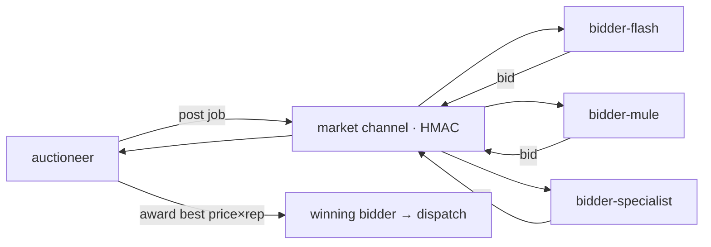

<div align="right">

[](LICENSE)
[](https://github.com/toxicwind/gavel)
[](https://python.org)

</div>

# 🔨 gavel

**The auction market for dispatches.** Gavel runs an auctioneer and a field of
bidders over a single [squawk message channel](../mesh/squawk/): the auctioneer posts a job, the
bidders bid, and the best bid (price × reputation) wins and owns the dispatch.
Every message is HMAC-signed on the frozen `market/v1` wire.

## Why you should care

Distributing work by first-come is a gamble; by vibes is a lottery. Gavel turns
dispatch into a **market**: bidders with good reputation and honest pricing win
more work, and the auctioneer can calibrate cost/latency/reliability per job.

## Features

- **Auctioneer** — posts jobs, collects bids, awards to the best (price × reputation).
- **Bidders** — fleets of agents with budgets, profiles, and reputation ledgers (`bidder-flash`, `bidder-mule`, `bidder-specialist`).
- **HMAC-signed wire** — the frozen `market/v1` protocol over the [squawk channel](../mesh/squawk/); body covered, no tampering.
- **Reputation system** — past performance updates bidder reputation; reputation is a first-class input to award, not a garnish.
- **E2E harness** — `e2e/` runs real auctioneer × bidder pools against tasks with real acceptance checks.
- **Calibration** — `calibration.json` tunes the award curve.

## How it works



## Quick start

```bash
cd gavel
./run-auctioneer.sh                      # start the auctioneer
./post-task <task-id> <workload.yaml>    # post a job to the market
./e2e/run_e2e.py --real-pool            # full auctioneer×bidder pool E2E
```

## Architecture

```
gavel/
├── market.py            # the frozen market/v1 squawk wire (HMAC over body)
├── auctioneer.py        # posts jobs, collects bids, awards
├── bidder/              # bidder fleet: logic, executor, profiles, reputation
│   ├── bidder.py
│   ├── bid_logic.py
│   ├── executor.py
│   ├── profiles.py
│   └── reputation.py    # reputation ledger updates
├── reputation/          # per-bidder-reputation JSON fixtures
├── calibration.json     # award-curve tuning
├── e2e/                 # real auctioneer×bidder-pool harness
├── post-task            # CLI to post a job
├── run-auctioneer.sh    # cheap auctioneer launcher
└── test/                # bidder smoke tests
```

## The wire

`market.py` implements the frozen protocol (WIRE.md): a public `market` squawk
channel on the [squawk bus](../mesh/squawk/), standard squawk frontmatter, body =
human header + `market/v1` marker + YAML block; **HMAC covers the whole body**.
The wire lives in one place so the auctioneer and every bidder stay in lockstep.

## License & security

MIT — the wire is HMAC-signed; keys live on the box, never in the repo. Bidders
are real subprocesses; the market trusts its registry of bidder profiles.